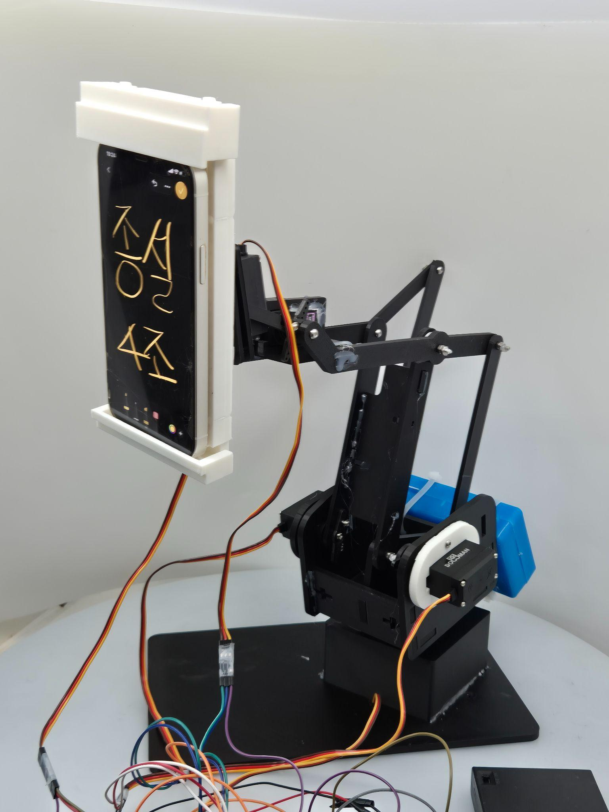
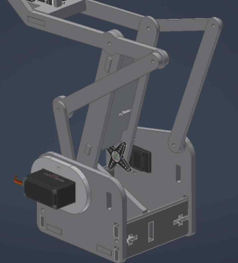
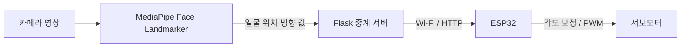
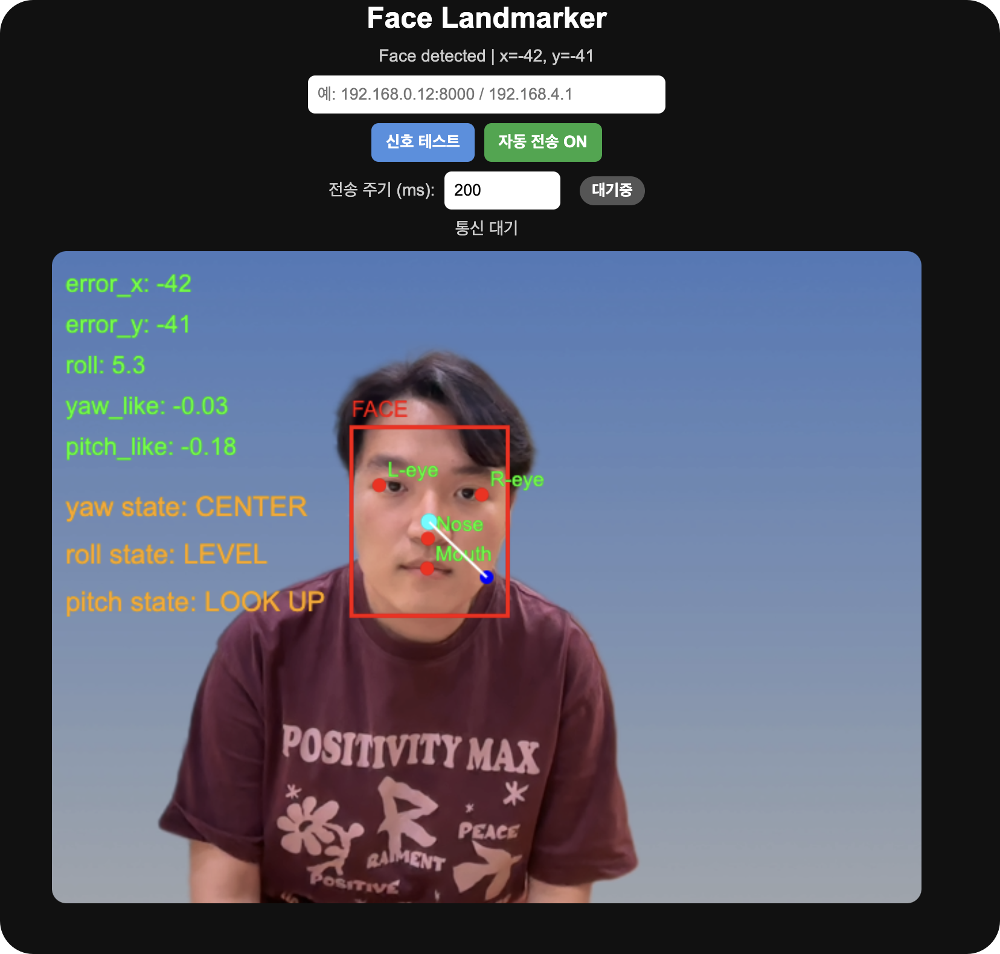

# 얼굴 추적 기반 자동 스마트폰 거치대

**성균관대학교 기계공학부 · 종합설계실습 (2026) · 6인 팀프로젝트**

사용자의 얼굴 위치를 인식하고 그에 맞춰 스마트폰의 방향을 조절하는 **5자유도 자동 거치대**를 설계·제작했다. 카메라에서 얻은 얼굴 좌표를 무선으로 전달하고, 서보모터 제어 명령으로 연결하는 프로젝트였다.

**[구동 영상 보기](https://www.youtube.com/watch?v=VJqOXbWMBSI)** · [설계 과정](docs/design_journey.md) · [제어 알고리즘](docs/control_algorithm.md) · [실험 결과](docs/results.md) · [English](README_EN.md)

*최종 제작 시제품 · 사진을 클릭하면 구동 영상을 볼 수 있다.*

## 프로젝트 기여

팀에서는 얼굴 랜드마크 추출과 Flask 서버 중계를 분담해 개발했고, **ESP32와 서보모터를 이용한 실제 구동부**를 중심으로 참여했다.

- **전원·회로:** MG996R 서보모터 5개와 ESP32가 함께 동작하도록 모터용 외부 전원, 전원 분리, 공통 접지와 배선 구성을 설계하고 시험했다.
- **모터 제어:** 얼굴 위치 데이터에 따라 서보 각도를 보정하는 코드를 구현·조정했다. PID를 구상했지만 실제 프로토타입에서는 비례제어, 데드존, 명령당 이동각 제한을 적용했다.
- **기구 개선:** 시제품 제작 이후 조립·구동 과정에서 확인한 문제를 바탕으로 CAD 형상 수정에 참여했다.

## 프로젝트 배경

화상회의나 촬영 도중 사용자가 움직일 때마다 거치대의 위치와 각도를 직접 조절해야 하는 불편을 줄이고 싶었다. 예비발표 과정에서 24명을 조사했으며, **62.5%가 수동 각도 조절을 불편 요소**로 꼽았다. 이를 바탕으로 얼굴을 따라 움직이는 다관절 거치대를 개발하기로 했다.

## 5축 기구 설계와 개선

베이스 회전, 이중 피치 관절, 거리 조절, 화면 기울기 보정을 위해 **서보모터 5개를 사용하는 5자유도 구조**를 제작했다.

초기 구조에서는 상부에 배치한 모터의 하중이 하부 관절에 크게 작용했다. 이를 줄이기 위해 구동부를 베이스 쪽으로 옮기고 **평행 링크를 통해 움직임을 전달하는 구조**를 적용했다. 전방에 쏠린 무게중심을 보완하기 위해 **후방 500g 카운터웨이트**도 추가했다.

이 과정에서 검토한 설계 대안과 구조 변경은 [Design Journey](docs/design_journey.md)에 정리했다.

## 얼굴 인식과 모터 제어

웹에서 얼굴 중심 오차와 방향 관련 값을 계산하고, Flask 서버를 거쳐 ESP32에 전달했다. 처음에는 **PID 제어**를 고려했지만, 실제 구동에서는 작은 좌표 변화와 통신 지연, 기구부 유격 때문에 모터의 움직임이 불규칙해지는 문제가 있었다.

최종 프로토타입에서는 **비례제어(P Control)와 데드존, 한 번에 움직이는 각도 제한**을 이용해 불필요한 움직임을 줄이는 방향으로 구현했다. 저장된 펌웨어의 설정값은 X축 25px·Y축 20px 데드존, 명령당 최대 이동각 4°이다.

*실제 얼굴 추적 화면 — 얼굴 중심 오차와 yaw·pitch·roll 관련 값을 확인할 수 있다.*

## 구현 및 실험 결과

| 항목 | 최종발표 결과 |
|---|---:|
| 얼굴 영상 처리 속도 | **22.23 FPS** |
| 얼굴 Yaw 추정 평균 절대오차 | **2.78°** |
| 얼굴 위치 변경 후 평균 안정화 시간 | **1.54초** |
| 영상 처리부터 모터 응답 시작까지의 지연 사례 | **35ms** |
| 연속 구동 시험 | **20분** |

*최종발표 당시 시험 기록이며, 각 측정 방법과 결과 화면은 [실험 결과](docs/results.md)에 정리했다.*

실물 제작을 통해 얼굴 위치를 따라 움직이는 거치대를 완성했다. 동시에 **얼굴을 인식하는 것과 안정적으로 추적하도록 움직이는 것은 다른 문제**라는 것도 확인했다. 기구 하중, 제어 명령의 크기, 통신 지연이 하나의 시스템 안에서 함께 영향을 준다는 점이 가장 기억에 남았다.

## 코드와 자료

[웹 인터페이스](web/index.html) · [Flask 서버](relay/server.py) · [ESP32 펌웨어](firmware/EC2_0512_ver/EC2_0512_ver.ino) · [기구 시뮬레이션](simulation/) · [CAD 이미지](assets/cad/) · [시스템 구성](docs/architecture.md) · [실행 방법](docs/setup.md)

최종 시제품은 5개 모터로 구성한 5축 기구다. 이 저장소에 보관한 ESP32 소스는 개발 과정의 **4채널 버전**으로, 자동 얼굴 추적 보정은 Pan·Tilt에 적용한다.
