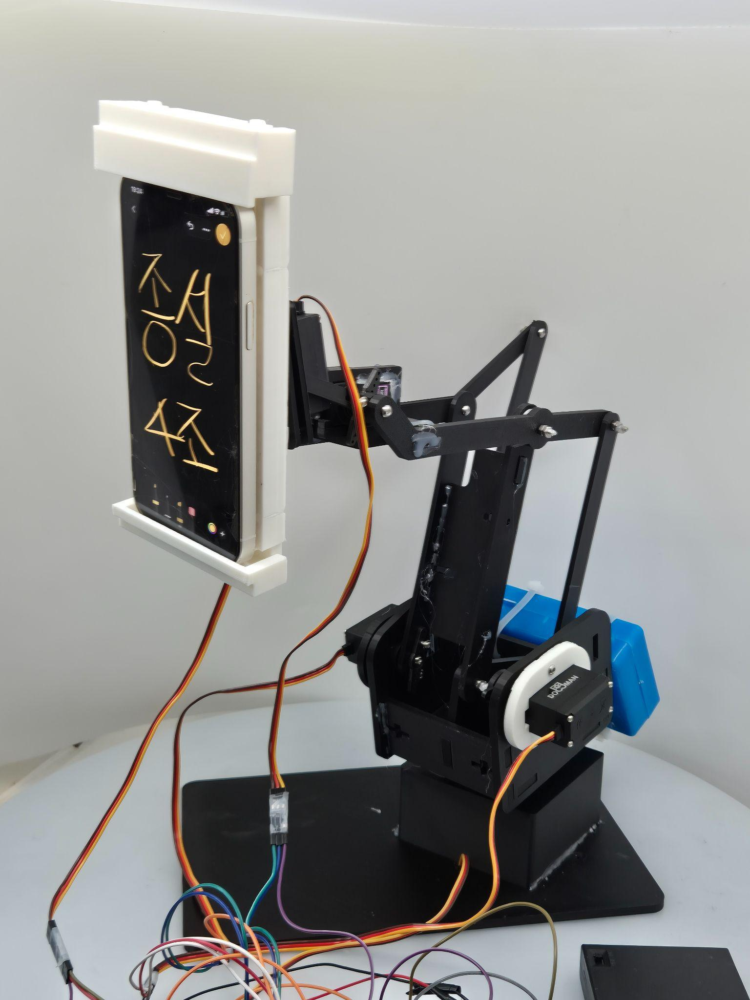
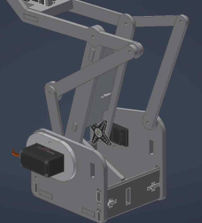
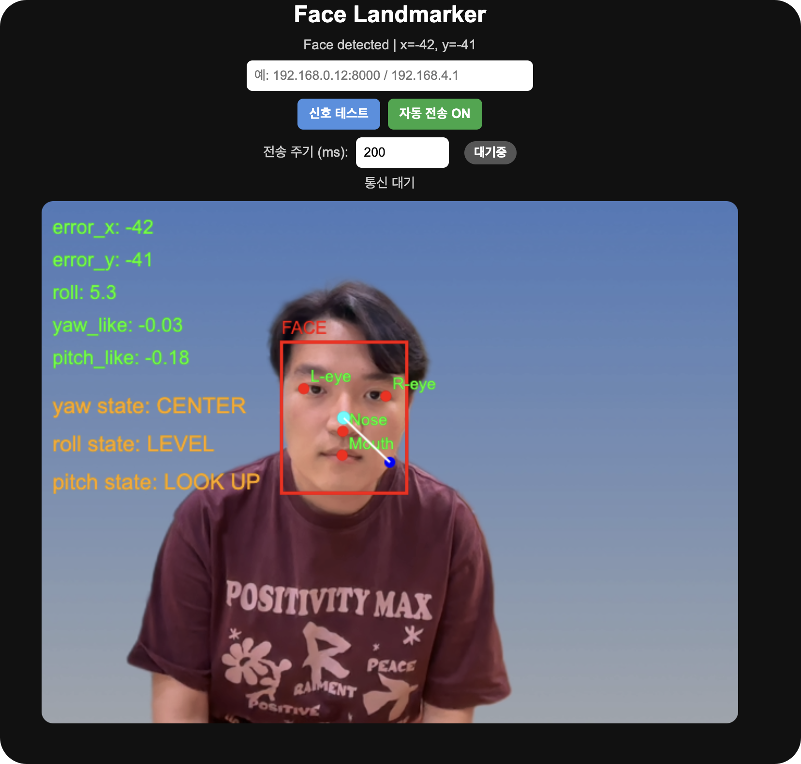

# Face-Tracking Smartphone Holder

**Mechanical Engineering Capstone Design · Sungkyunkwan University · 2026 · Six-member team project**

We designed and built a **five-degree-of-freedom smartphone holder** that responds to a user's face position. Camera-based tracking data are transmitted over Wi-Fi and converted into servo commands.

**[Watch the prototype demo](https://www.youtube.com/watch?v=VJqOXbWMBSI)** · [Design journey](docs/design_journey.md) · [Control logic](docs/control_algorithm.md) · [Test results](docs/results.md) · [한국어](README.md)

*Final prototype — click the photo to watch it operate.*

## My role

I focused on the **ESP32-based servo drive and control system**. Face landmark extraction and the Flask relay were primarily developed by another team member.

- **Power and wiring:** Designed and tested the separated servo power supply and common-ground wiring for five MG996R servos operating alongside the ESP32.
- **Motor control:** Implemented and adjusted proportional angle correction, dead zones and a per-command angular step limit. PID was considered initially, but the prototype used this simpler control logic.
- **Mechanical iteration:** Participated in CAD geometry revisions after the first physical prototype was assembled and tested.

## Motivation

Conventional holders require repeated manual adjustment when a person moves during a call or recording. In our initial survey of 24 respondents, **62.5% identified manual angle adjustment as an inconvenience**. We chose a multi-joint design that could follow the user's face.

## Mechanical design and iteration

The prototype used **five servos** for base rotation, two pitch joints, distance adjustment and roll compensation. Positioning a motor near the upper joint increased the load carried by lower joints. We moved the drive closer to the base and used a **parallel linkage** to transmit motion. We also added a **500 g rear counterweight** to address the forward-shifted center of mass.

See the [design journey](docs/design_journey.md) for the alternatives and changes we considered.

## From face tracking to servo motion

The web interface computes face-center errors and orientation-related signals, and a Flask relay forwards them to an ESP32. We initially considered **PID control**, but small coordinate variations, communication delays and mechanical play affected the prototype's motion. The implemented tracking logic therefore uses **proportional corrections, dead zones and a maximum angular step per message**.

*Face-tracking interface used during the project.*

## Results

| Metric | Final presentation |
|---|---:|
| Face-processing rate | **22.23 FPS** |
| Mean absolute yaw-estimation error | **2.78°** |
| Mean settling time after face movement | **1.54 s** |
| Example processing-to-servo response delay | **35 ms** |
| Continuous operation test | **20 minutes** |

*See [test results](docs/results.md) for the measurement conditions and screenshots.*

The main lesson was that reliable motion depended on the complete system, not face detection alone: mechanical loads, control commands and communication timing all mattered.

## Source

[Web](web/index.html) · [Flask relay](relay/server.py) · [ESP32 firmware](firmware/EC2_0512_ver/EC2_0512_ver.ino) · [Simulation](simulation/) · [CAD](assets/cad/) · [Architecture](docs/architecture.md) · [Setup](docs/setup.md)

The physical prototype used five servo motors. The retained ESP32 source is a **four-channel development version**, with automatic tracking corrections applied to pan and tilt.
