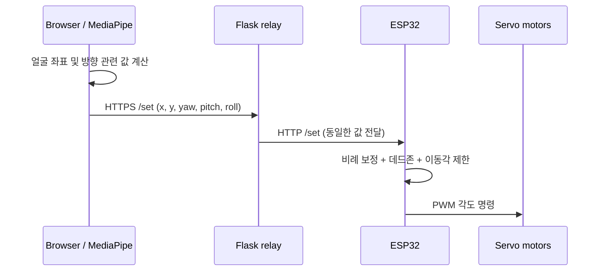

# 시스템 구성

## 1. 입력 데이터

`web/index.html`에서 MediaPipe Face Landmarker로 얼굴의 랜드마크를 추출한다. 얼굴 중심과 화면 중심 간의 오차인 `x`, `y`, 좌우·상하 방향과 관련된 `yaw`, `pitch`, 얼굴 기울기 `roll`을 계산한다. 웹 코드에서 사용하는 `yaw`, `pitch`는 랜드마크 비율 기반 값이며, 보정된 실제 각도(°)와는 다르다.

## 2. 데이터 전달

`relay/server.py`가 브라우저의 HTTPS 요청을 받아 ESP32의 HTTP `/set`으로 전달한다. 웹 기본 전송 주기는 **200ms**이며, 화면에서 변경할 수 있다. 서버는 요청의 성공·실패를 반환한다.

## 3. ESP32 및 모터 구동

최종 시제품은 **서보모터 5개를 사용한 5자유도 구조**다. 이 저장소에 있는 `EC2_0512_ver.ino`는 제작 과정의 4채널 버전이며, 다음과 같이 구성돼 있다.

| 채널 | GPIO | 코드에서의 역할 |
|---|---:|---|
| Servo 1 | 18 | Pan 자동 보정, 20–160° |
| Servo 2 | 19 | Tilt 자동 보정, 40–140° |
| Servo 3 | 21 | 직접 각도 명령, 0–180° |
| Servo 4 | 22 | 직접 각도 명령, 0–180° |

네 채널 모두 PWM 출력 주기는 **50Hz**다. `roll`은 전달되지만 이 펌웨어의 자동 보정량에는 사용되지 않는다.

## 4. 하드웨어 구성과 전원·회로

- **최종 기구:** MG996R 서보모터 5개를 사용하는 다관절 구조. 평행 링크로 말단부 자세를 조절했다.
- **구동 전원:** 다섯 모터의 동시 구동을 고려해 서보용 외부 전원과 ESP32 제어부 전원을 분리하고 GND를 공통 연결했다. 실제 전원 용량은 사용하는 모터와 부하 조건에 맞게 확인해야 한다.
- **기구 개선:** 후방 카운터웨이트를 이용해 전방으로 쏠린 무게중심을 보완했다.

전원·회로 구성과 ESP32 모터 제어를 중심으로 작업했고, 시제품 제작 후 CAD 형상 수정에도 참여했다. MediaPipe 얼굴 랜드마크 추출과 Flask 중계는 팀 내 별도로 분담한 부분이다.

[제어 알고리즘](control_algorithm.md) · [설계 과정](design_journey.md) · [실험 결과](results.md)
