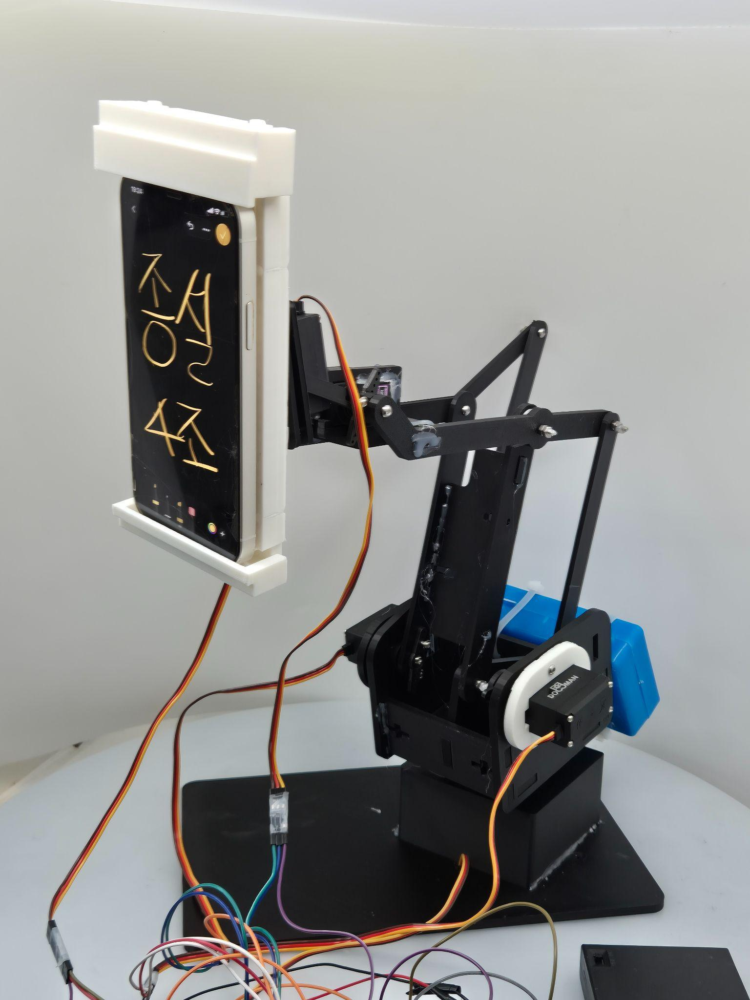
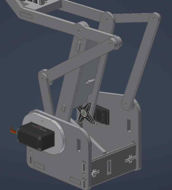
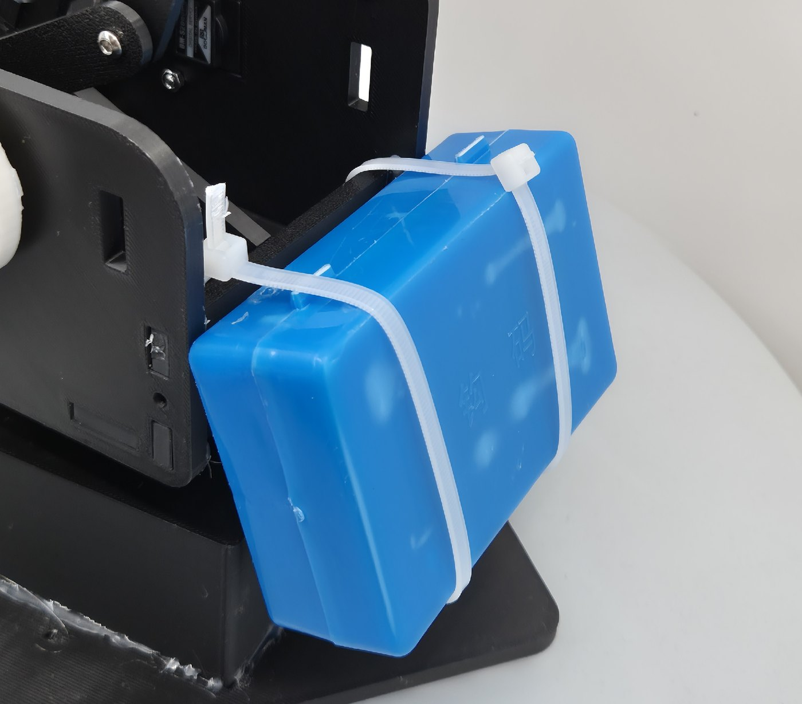

# Design Journey — 설계안에서 실제 시제품까지

## 1. 설계 시작

처음에는 자동으로 움직이는 스마트폰 거치대가 실제로 필요한지부터 확인했다. 시중 제품을 살펴보니 수동형은 각도를 직접 맞춰야 했고, 자동 추적형은 회전 범위나 조절 가능한 방향에 제약이 있었다.

24명을 대상으로 진행한 설문에서 15명(62.5%)이 **수동 각도 조절**을 불편 사항으로 선택했다. 시야 제한과 지지력 문제는 각각 8명(33.3%), 반복 조작의 피로는 7명(29.2%)이 응답했다. 자동 추적의 필요성에 긍정적으로 답한 비율은 66.6%였다.

## 2. 어떤 구조로 만들 것인가

예비발표 때는 세 가지 방향을 비교했다.

| 설계안 | 방향 | 고려한 점 |
|---|---|---|
| A | 받침대 크기 확대 | 안정성은 높이되 전체 크기와 사용 편의성에 제약 |
| B | 얼굴 추적 + 넓은 회전 범위 + 무선 통신 | 사용자 움직임에 대응하지만 제어·기구·통신 통합이 필요 |
| C | 기존 구조 부분 보강 | 비교적 단순하지만 대응 가능한 움직임이 제한적 |

결국 **B안의 실시간 추적 기능과 다관절 기구**를 중심으로 제작했다. 베이스 회전, 이중 피치 관절, 전후 거리 조절, 화면 기울기 보정을 위한 5자유도 구조다.

## 3. 모터 위치 변경

초기에는 상부 관절에 모터를 배치했지만, 모터 질량이 베이스 회전축에서 멀어질수록 하부 관절의 부담이 커졌다. 중력 모멘트는 모멘트암에, 관성 모멘트는 거리의 제곱에 영향을 받는다.

\[
M_g \approx mgr, \qquad J \propto mr^2
\]

이 때문에 **모터를 베이스 가까이 배치하고 평행 링크로 운동을 전달하는 방식**으로 변경했다. 같은 동작을 만들더라도 구동부의 위치가 관절 부하와 진동에 영향을 준다는 점을 설계에 반영했다.

## 4. 무게중심 보완

휴대폰과 홀더가 전방에 놓이면서 무게중심이 앞쪽으로 쏠렸다. 최종발표에서는 약 **8.3 kgf·cm의 전방 편심 모멘트**를 설계상 문제로 정리했고, **500g의 후방 카운터웨이트**로 약 **3.75 kgf·cm의 보정 모멘트**를 확보하는 방안을 적용했다.

## 5. 다섯 개 서보와 ESP32를 함께 구동하기

MG996R 모터 5개를 동시에 움직이는 구조에서는 모터 구동에 필요한 전원을 ESP32 제어부와 어떻게 구성할지도 중요한 문제였다. 모터 전원은 별도로 공급하고 ESP32와 모터 전원의 GND를 공통으로 연결해 제어 신호의 기준을 맞췄다. 나는 이 전원·회로 구성과 배선, 모터 구동 시험을 중심으로 작업했다.

기구부에서는 시제품을 실제로 조립하고 움직여 본 뒤 CAD 형상 수정에도 참여했다. 화면에서 설계한 형상이 실제 부품의 간섭이나 구동 범위까지 모두 해결해 주는 것은 아니었다.

## 6. PID 구상에서 프로토타입 제어로

처음에는 PID 제어를 고려했다. 하지만 얼굴 랜드마크가 조금만 움직여도 좌표가 변했고, 통신 지연과 관절 유격이 더해지면 모터가 불규칙하게 반응했다.

내가 구현·조정에 참여한 ESP32 제어부에서는 **비례형 각도 보정**을 기본으로 하고, 작은 위치 오차에는 **데드존**, 큰 명령에는 **이동각 제한**을 두었다. 위치 오차에 반응하는 능력과 불필요한 구동을 줄이는 것 사이에서 균형을 잡기 위한 선택이었다.

최종 기구는 다섯 개의 서보를 사용했지만, 이 저장소에 남은 펌웨어는 Pan·Tilt 자동 추적과 두 개의 직접 구동 채널을 가진 개발 버전이다. 구현 코드에 대한 자세한 설명은 [제어 알고리즘](control_algorithm.md)에 정리했다.

## 7. 완성 후

카메라, 서버, ESP32, 서보모터를 연결해 실제 움직임을 확인했고, 최종발표에서는 처리 속도와 안정화 시간 등을 측정했다. 다만 미세한 진동과 통신 지연은 남았다.

이번 프로젝트에서 가장 크게 느낀 점은 **설계한 기능을 실제로 움직이게 하려면 제어 알고리즘뿐 아니라 기구의 하중과 통신 특성까지 함께 고려해야 한다**는 것이었다.

[구동 영상](https://www.youtube.com/watch?v=VJqOXbWMBSI) · [실험 결과](results.md) · [메인 README](../README.md)
